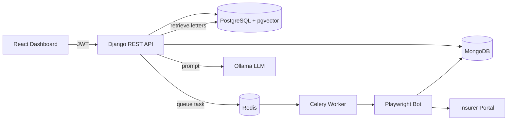
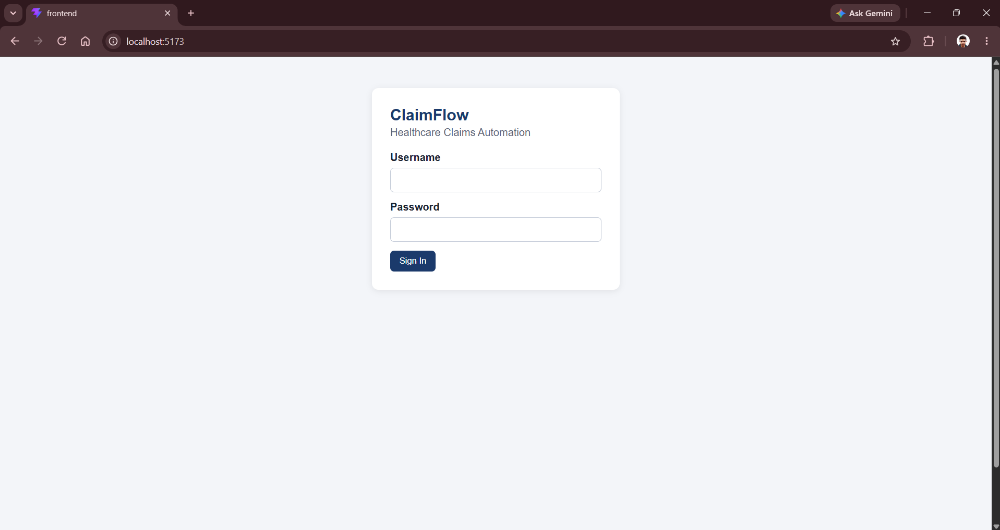
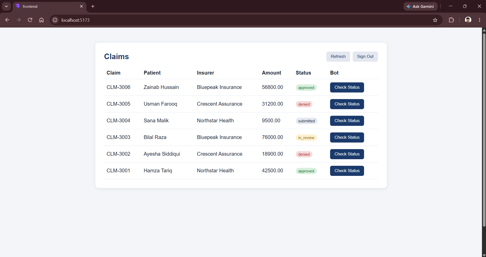
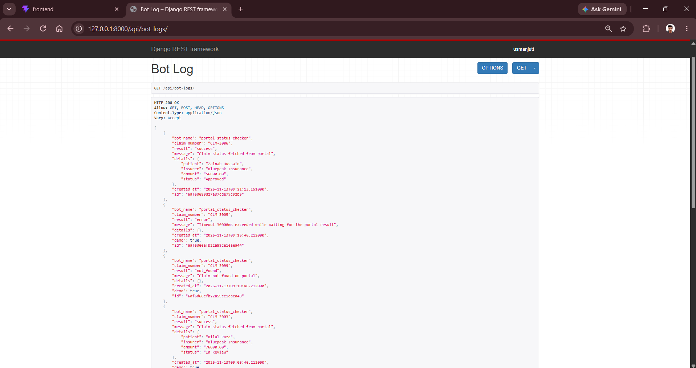
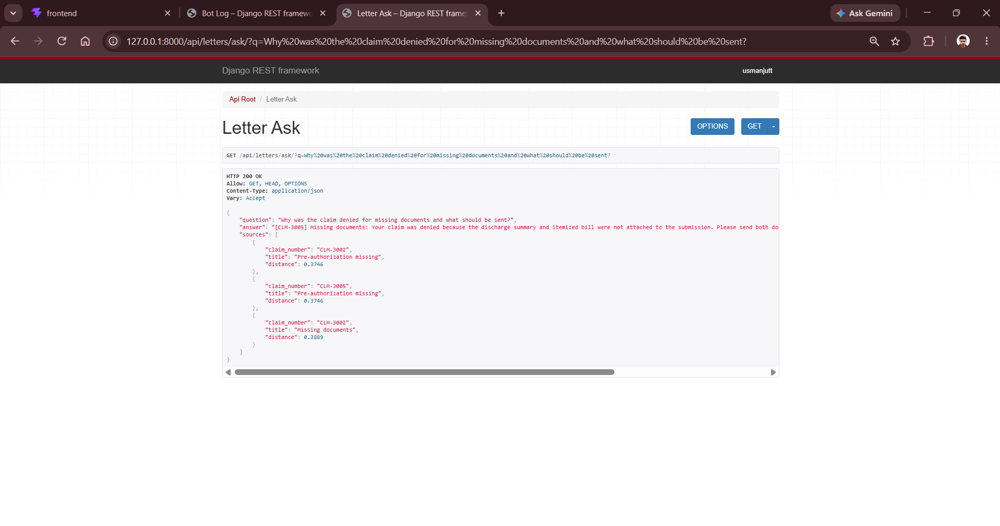

# ClaimFlow

ClaimFlow is a healthcare claims automation platform. It tracks insurance claims, runs browser bots that check claim status on an insurer portal, stores bot logs, and answers questions about claim denial letters using a local LLM.

Built by [ForgeHold Technologies](https://forgeholdtech.github.io).

## Features

- Claims management API with JWT authentication
- Playwright bot that reads claim status from an insurer portal
- Background job processing with Celery and Redis
- Bot run logs stored in MongoDB
- Semantic search over denial letters with PostgreSQL and pgvector
- Question answering over denial letters (RAG) with LangChain and a local Ollama model
- React dashboard with login, claims table and one-click bot runs
- Automated tests and GitHub Actions CI
- Dockerized API with Gunicorn and WhiteNoise

## Architecture



## Tech Stack

| Area | Technology |
| --- | --- |
| Backend | Python, Django, Django REST Framework, SimpleJWT |
| Databases | PostgreSQL with pgvector, MongoDB |
| Background jobs | Celery, Redis |
| Automation | Playwright |
| AI | LangChain, Ollama, sentence-transformers |
| Frontend | React, Vite |
| DevOps | Docker, Docker Compose, GitHub Actions, Gunicorn, WhiteNoise |

## Screenshots

| Login | Dashboard |
| --- | --- |
|  |  |

| Bot logs | Question answering |
| --- | --- |
|  |  |

## Project Structure

```
claimflow/
  bots/                 Playwright claim status bot
  claims/               Django app: models, API, portal, Celery tasks, RAG
  config/               Django project settings and Celery app
  frontend/             React dashboard
  .github/workflows/    CI pipeline
  docker-compose.yml    PostgreSQL, MongoDB, Redis and API services
  Dockerfile            API image
```

## Getting Started

### Prerequisites

- Python 3.12
- Node.js (LTS)
- Docker Desktop
- Ollama with a pulled model, for example `ollama pull qwen2.5:3b-instruct`

### 1. Environment file

Create a `.env` file in the project root:

```
DB_NAME=claimflow
DB_USER=claimflow
DB_PASSWORD=claimflow_pass
DB_HOST=127.0.0.1
DB_PORT=5433
MONGO_URI=mongodb://127.0.0.1:27018
MONGO_DB=claimflow_logs
REDIS_URL=redis://127.0.0.1:6380/0
OLLAMA_URL=http://127.0.0.1:11434
OLLAMA_MODEL=qwen2.5:3b-instruct
```

### 2. Start the databases

```
docker compose up -d db mongo redis
```

### 3. Backend

```
python -m venv venv
venv\Scripts\activate
pip install -r requirements.txt
playwright install chromium
python manage.py migrate
python manage.py createsuperuser
python manage.py runserver
```

### 4. Celery worker

Open a second terminal with the virtual environment activated:

```
celery -A config worker --pool=solo -l info
```

### 5. Frontend

```
cd frontend
npm install
npm run dev
```

Open `http://localhost:5173` and sign in with the superuser account.

## API Overview

All endpoints require a JWT access token except the token endpoints and the portal.

| Method | Endpoint | Description |
| --- | --- | --- |
| POST | `/api/auth/token/` | Obtain access and refresh tokens |
| POST | `/api/auth/token/refresh/` | Refresh an access token |
| GET, POST | `/api/claims/` | List or create claims |
| GET, PUT, PATCH, DELETE | `/api/claims/{id}/` | Retrieve, update or delete a claim |
| POST | `/api/claims/{id}/check-status/` | Queue the Playwright bot for a claim |
| GET, POST | `/api/bot-logs/` | List or create bot logs |
| GET | `/api/letters/search/?q=` | Semantic search over denial letters |
| GET | `/api/letters/ask/?q=` | Answer a question using retrieved letters |
| GET | `/portal/` | Demo insurer portal used by the bot |

## Running Tests

```
python manage.py test
```

Tests run automatically on every push through GitHub Actions.

## Run the API in Docker

```
docker compose up -d --build
```

The containerized API is available at `http://localhost:8001`.

## Planned Improvements

- Deploy to the cloud
- Containerize the Celery worker and the frontend
- Add more bots and insurer portals

## Author

Usman Ahmad

- GitHub: [github.com/ForgeHoldTech](https://github.com/ForgeHoldTech)
- Portfolio: [forgeholdtech.github.io](https://forgeholdtech.github.io)
- Email: uahmad1666@gmail.com